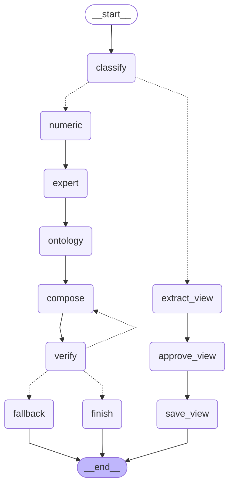

# 로컬 LLM 계층 설계 — 수치 · 전문가 의견 · 온톨로지 · LLM 인터페이스

작성 2026-11-03 · 상태: **1단계(도구층 + MCP 서버) · 2단계(LangGraph 4계층 흐름) 구현**, 대시보드 탭 · 평가 세트 · 의견 백테스트는 미착수
관련 파일: `llm/tools.py` · `llm/mcp_server.py` · `llm/graph.py` · `docs/LLM_graph.mmd` · `tests/test_llm_tools.py` · `tests/test_mcp_server.py` · `tests/test_llm_graph.py`

---

## 1. 목적 · 범위

- 대시보드의 분석 결과(변동성 · VaR · 레짐 · 요인 · 구매 판단 · 온톨로지)를 **말로 묻고 답하는 창구**를 만든다.
- 비공개 **전문가 의견을 구조화해 쌓고**, 검증 후에만 판단에 보탠다.
- 모든 처리는 **사내 PC 안에서만**(로컬 LLM) 이루어진다. 사내 정보를 외부 서비스로 보내지 않는다(업무 Protocol).

**하지 않는 것**
- LLM이 가격 방향을 예측하거나 숫자를 계산하지 않는다.
- 검증 결과 방향 예측은 우연 수준이었다(HANDOFF §3, 온톨로지 실험 8건). 따라서 이 계층의 1차 가치는 **설명 · 조회 · 기록**이다.

## 2. 4계층 구조

```
[외부 소스] Yahoo · FRED · akshare · USDA(WASDE·PSD·AgTransport) · NOAA · CFTC · EIA …
      │   배치 수집기 (collect.py · causal_data.py · reports.py)  ← 인터넷은 여기서만, API 키는 .env
      ▼
[로컬 저장소] data/*.parquet · data/*_compare.csv · data/reports/*.parquet · data/expert/(사내)
      │
      ▼
[도구층 llm/tools.py]  ①수치 · ②전문가 의견 · ③온톨로지 · 그림   ← 숫자는 여기서만 만든다
      │
      ▼
[MCP 서버 llm/mcp_server.py]  stdio · 읽기 14 + 쓰기 1 · 호출 기록
      │
      ├─▶ [LangGraph 흐름] ── 로컬 LLM (Ollama, 127.0.0.1)          ← 2단계
      │       질문 분류 → 도구 호출 → 숫자 대조 → 답변(출처·기준일)
      ├─▶ Claude Desktop 등 다른 MCP 클라이언트 (사내 정보가 없을 때만)
      ▼
[④ 인터페이스] Streamlit 탭 ⑨ '물어보기'                             ← 2단계
```

| 계층 | 내용 | LLM 역할 | 상태 |
|---|---|---|---|
| ① 수치 데이터 | 가격 · GARCH 변동성 · VaR/ES · 레짐 · 요인(PCA · 스필오버) · 상관 · 구매 판단 · 실험 결과 | 없음 (인용만) | **구현** |
| ② 전문가 의견 | 트레이더 코멘트 · 기관 리포트 → 방향(−1~+1) · 신뢰도 · 근거 | 문장 → JSON 추출 | 저장·조회 **구현**, 추출 · 백테스트는 3단계 |
| ③ 온톨로지 | 곡물 2단 연결 · 계수 · 역추적(결과 → 원인 기여) | 결과를 문장으로 | **구현** |
| ④ 인터페이스 | 질의응답 · 그림 안내 | 도구 고르기 · 요약 | 2단계 |

## 3. 설계 원칙

1. **숫자는 도구만 만든다.** 답변의 숫자는 도구 결과와 자동 대조한다(2단계 '숫자 검증' 노드). 맞지 않으면 다시 쓰게 한다.
2. **모든 도구 결과에 `asof` · `method` · `source`를 붙인다.** 답변에 기준일과 방법을 표시하고, 감사 추적이 되게 한다.
3. **인터넷은 수집기만 쓴다.** 도구와 LLM은 로컬 파일만 읽는다.
   - 유출 방지: 질문 맥락이 외부 요청에 실리지 않는다.
   - 미래정보 차단: 수집기가 발표일 기준으로 정리한 자료만 쓴다.
   - API 키가 한곳(.env)에만 있다.
4. **결과는 작게.** 소형 로컬 모델(4B)의 문맥에 맞게 표는 최대 30행, 소수 3자리로 자른다.
5. **쓰기는 최소 · 승인제.** 쓰기 도구는 `save_expert_view` 하나이고 추가 기록만 한다. 사내 정보 폴더(`data/expert/`, `data/llm_logs/`)는 git에서 제외한다.
6. **흐름은 그래프가 정한다.** 작은 모델에 자유 에이전트를 맡기지 않는다. LangGraph의 고정 단계에서 LLM은 칸만 채운다. 자유 에이전트는 평가 점수가 나온 뒤 검토한다.

## 4. 1단계 구현: 도구 목록

| 도구 | 계층 | 내용 | 바탕 함수 · 라이브러리 |
|---|---|---|---|
| `list_items` | ① | 품목 70개 목록 · 그룹 · 단위 · 기간 | `analytics.load_catalog` |
| `get_prices` | ① | 가격 요약(현재 · 최저 · 최고 · 1주/1개월/1년 변화 · 분위) + 최근 30개 | pandas |
| `vol_forecast` | ① | GARCH · **GJR** · EGARCH(Student-t) 계수, 지속성, 반감기, 비대칭 γ, 현재 · h일 예측 연 변동성, RiskMetrics 비교 | **arch** `arch_model` |
| `var_es` | ① | h일 VaR · ES 5방법(정규 · t · FHS · EVT-GPD · 역사적), 명목 금액 환산, 백테스트(초과율 · Kupiec · Christoffersen · 바젤 신호등) | `risk.py` + **scipy.stats** |
| `regime` | ① | Markov 레짐 스위칭(평균 · 분산 전환): 레짐별 평균 · 변동성 · 지속기간, 현재 확률 | **statsmodels** `MarkovRegression` |
| `factors` | ① | 요인 구조: PCA(공통 요인 몫 · 적재값) + Diebold-Yilmaz 스필오버(총 연계도 · 순 전이) | numpy, **statsmodels** `VAR` |
| `correlation` | ① | 최근 vs 이전 기간 상관(동조성 변화) | pandas |
| `buy_signal` | ①→결정 | ★ 탭 '지금 살까' 점수 · 구성요소 · 4주 90% 범위 · 권장 속도 | `procurement.today_table` |
| `fundamentals` | ① | WASDE 재고율 · 전월 대비 · 같은 달 분위, CFTC 순포지션 | `procurement.fundamentals` |
| `get_results` | ① | 백테스트 · 실험 결과표 48개(`*_compare.csv`, `causal_*.csv`) 조회 | pandas |
| `ontology_graph` | ③ | 2단 온톨로지 노드 · 연결 44개 + 계수(전체 · 두 기간 · 부호 안정) | `causal_grain.GRAPHS` |
| `ontology_attribution` | ③ | 기간 누적 변동을 원인 충격 · 경로별 기여로 분해(정확 분해) | `causal_grain.attribution` |
| `expert_views` | ② | 저장된 전문가 의견 조회 | pandas |
| `save_expert_view` | ② **쓰기** | 의견 1건 추가(방향 · 신뢰도 · 근거 · 작성자 · 기간), 범위 검사 | → `data/expert/views.csv` |
| `make_chart` | 그림 | Plotly HTML: 가격 · 변동성(GJR vs EWMA) · 레짐 확률 · VaR 백테스트 | **plotly** |

**검증:** `tests/test_llm_tools.py`
- 모든 도구가 JSON으로 직렬화되고 asof · method · source가 붙는지 확인한다.
- 대시보드 함수와 같은 숫자인지 확인한다(구매 점수 · EWMA 변동성).
- VaR는 ES ≥ VaR, 금액 = % × 명목 관계를 확인한다.
- 역추적은 기여 합이 실제 누적과 같은지 확인한다.
- 잘못된 입력은 분명한 오류를 내는지 확인한다. 약 7초 소요.

## 5. 분석 방법론 · 시각화 라이브러리 지도

도구 안(서버 쪽)에서 쓰는 라이브러리이며, LLM이 직접 부르지 않는다. 새 라이브러리는 **설치 승인 → 도구 하나로 감싸기 → 테스트** 순서로 추가한다.

### 5-1. 지금 대시보드가 쓰는 것 (설치됨)

| 분야 | 방법 | 라이브러리 / 자체 구현 | 도구 노출 |
|---|---|---|---|
| 변동성 | GARCH · GJR · EGARCH | `arch` 8.0 | ✅ `vol_forecast` |
| 변동성 | EWMA(품목별 · 시변 λ) · HAR-RV · MIDAS · GARCH-MIDAS | 자체(`risk.py`, `midas.py`) | EWMA만(1-b 후보: `vol_models` 비교표) |
| 다변량 변동성 | DCC · 비대칭 DCC · BEKK(전이) | 자체(`mvgarch.py`) | 1-b 후보(계산이 무거움 → 결과 캐시 필요) |
| 위험 | VaR/ES 5방법, Kupiec · Christoffersen · ES 검정, 꼬리 의존 · 스트레스 · 위기 시나리오 | 자체(`risk.py`) + `scipy` | ✅ `var_es` (스트레스 · 시나리오는 1-b) |
| 레짐 | Markov 스위칭 · HMM(가우시안, 거시 포함) · TAR/STAR · TVP-VAR | `statsmodels` · `hmmlearn` · 자체(`regime.py`, `regime_mv.py`) | ✅ `regime`(Markov) · HMM 다변량은 1-b |
| 요인 | PCA · 흡수 비율 · DY 스필오버 · 패널 요인 | numpy · `statsmodels` · `linearmodels` | ✅ `factors` |
| 예측 · ML | Ridge/Lasso/MCP · Kalman TVP · LightGBM · LSTM · Chronos/TimesFM/TiRex · Prophet · NeuralForecast | `scikit-learn` · `lightgbm` · `torch` · 각 패키지 | 결과표만(`get_results`), 실시간 재계산 안 함 |
| 인과 · 온톨로지 | 선형 SCM · 역사적 분해 · PCMCI(ParCorr) · 이벤트 연구 | 자체(`causal_grain.py`) | ✅ `ontology_*` |
| 시계열 진단 | STL · ADF · KPSS | `statsmodels` | 2단계 후보 |
| 시각화 | 인터랙티브 차트 · 3D | `plotly` 7.1 (대시보드 · 발표 HTML) | ✅ `make_chart` |
| 시각화 | 정적 그림 | `matplotlib` (발표 PPT) | — |

### 5-2. 추가 후보 (설치 안 됨, 각각 승인 필요)

| 분야 | 후보 | 쓰임 | 판단 |
|---|---|---|---|
| LLM 계층 | `mcp`(공식 Python SDK) | MCP 서버 실행 | **1단계 필수**: 서버 기동 시험에 필요 |
| LLM 계층 | `langgraph` (설치함 1.2.19) | 4계층 흐름 · 사람 확인(interrupt) | 2단계 — `langchain-ollama` · `langchain-mcp-adapters`는 불필요로 판단(직접 호출) |
| 포트폴리오 · 위험 | `riskfolio-lib` 또는 `skfolio` | CVaR · CDaR · 위험 예산 최적화, 효율적 투자선 표준 구현과 우리 자체 구현 대조 | 권장(검증용) |
| 성과 보고 | `quantstats` | 수익 · MDD · 롤링 Sharpe 보고서 HTML | 선택 |
| 인과 | `tigramite` | PCMCI 공식 구현(자체 구현 대조, PCMCI+ · 비선형 CMI) | 권장. 이전에 자동 승인에서 거부됨 → 사용자 승인 필요 |
| 인과 | `dowhy` | 인과 가정 명시 · 반박 검정 | 선택 |
| 시계열 | `statsforecast` | ARIMA · ETS · GARCH 고속 기준 모형 | 선택 |
| 온톨로지 | `networkx` + `pyvis` | 온톨로지 그래프 계산 · 인터랙티브 네트워크 HTML | 권장(③ 시각화) |
| 온톨로지 | `rdflib` 또는 임베디드 그래프 DB(`kuzu`) | 표준 RDF/OWL 저장 · 질의(노드가 수백 개로 늘 때) | 보류 |
| 문서 검색(RAG) | `lancedb` 또는 `chromadb` + Ollama 임베딩 모델 | 리포트 · 전문가 코멘트 문장 검색(로컬 벡터 저장소) | 3단계 |
| 그림 → PNG | `kaleido` | Plotly 그림을 PNG로(보고서 · 메일 첨부) | 선택 |

> 각 패키지의 현재 버전 · 라이선스 · 한국어 임베딩 품질은 설치 전에 확인한다(이 문서 작성 시점 **확인 안 됨**).

### 5-3. 외부 MCP 서버 활용 방침

| 종류 | 예 | 방침 |
|---|---|---|
| 로컬 파일 · DB 읽기 | 공식 참조 서버 `filesystem`(허용 폴더 지정), DuckDB/SQLite 계열 | 문서 폴더 읽기 전용으로만 검토 |
| 인터넷 가져오기 | 공식 `fetch` 등 | **연결하지 않음**: 사내 맥락이 외부 요청에 실릴 위험 |
| 외부 데이터 벤더 | 시세 · 뉴스 벤더 MCP | 배치 수집기로 받는 방식 유지. 실시간 연결은 보안 검토 후 |

**"외부 소스마다 MCP를 만들어야 하나"에 대한 결론:** 만들지 않는다. 구조도의 외부 연동 14개는 **수집기 단계**에 두고, MCP는 그 결과(로컬 저장소)만 노출한다. 대신 1-b에서 `data_sources` 도구(소스별 마지막 수집일 · 행 수 · 실패 여부)를 추가해, LLM이 "자료가 얼마나 최신인가"를 답할 수 있게 한다.

## 6. LangGraph 4계층 흐름 (구현: `llm/graph.py`)

대시보드·발표 자료에는 아직 넣지 않습니다(2026-11-03 사용자 결정). 흐름은 실행 가능한 코드와 테스트로만 둡니다.

**흐름도** — 코드에서 자동 생성(`python -m llm.graph --mermaid` → `docs/LLM_graph.mmd`). VS Code 미리보기·GitHub에서 그림으로 보입니다. 점선 = 조건 분기.



| 노드 | 계층 | 하는 일 | LLM 사용 |
|---|---|---|---|
| `classify` | — | 키워드 규칙으로 질문 유형(조회 · 판단 · 설명 · 방향 · 의견 기록), 품목('대두박'≠'대두', '지금'≠'금'), 인자(기간 · 신뢰수준 · 금액 · 매입 예정) 추출 | 없음 |
| `numeric` | ① 수치 | 유형별 도구 호출(가격 · 변동성 · VaR · 레짐 · 요인 · 상관 · 매수 점수 · WASDE) → **사실 목록**(숫자 · 기준일 · 방법이 든 문장) | 없음 |
| `expert` | ② 전문가 의견 | 판단 · 방향 · 설명 질문에 저장된 의견(신뢰도 가중 방향, '미검증 참고' 표시) 추가 | 없음 |
| `ontology` | ③ 온톨로지 | 설명 질문에 최근 4주(또는 지정 기간) 원인별 기여 · 유의 연결 추가. 온톨로지 밖 품목은 그렇다고 밝힘 | 없음 |
| `compose` | ④ LLM 인터페이스 | 사실 목록 → 결론 · 근거 · 한계 문장(로컬 Ollama, 온도 0.1) | **있음** |
| `verify` | ④ | 답변 숫자가 사실 목록 · 질문에 있는지 대조(반올림 허용), 방향 단정 금지 → 어기면 고칠 점을 붙여 `compose`로(최대 2회) | 없음 |
| `finish` / `fallback` | ④ | 통과하면 답변 + 출처 도구, 2회 실패 · LLM 꺼짐이면 **사실 목록 그대로**(숫자 정확성 우선) | 없음 |
| `extract_view` → `approve_view` → `save_view` | ② 쓰기 | 의견 문장 → JSON(방향 · 신뢰도 · 기간 · 작성자, LLM + 규칙 보정) → **사람 확인(`interrupt`)** → 승인 시에만 저장 | 추출만 |

구현 선택 (설계 초안에서 바뀐 점)
- **패키지는 `langgraph` 하나만 추가.** 로컬 LLM은 Ollama HTTP(`127.0.0.1:11434`, 다른 주소는 거부)를 `requests`로 직접 부르고, MCP는 이미 설치한 `mcp` 클라이언트로 부릅니다. `langchain-ollama`·`langchain-mcp-adapters`는 쓰지 않습니다(설치 · 의존성 최소화).
- **도구 호출 2방식:** 기본 `direct`(같은 프로세스에서 import, 빠름) · `--mcp`(MCP 서버 경유). 테스트에서 두 방식의 사실 목록이 같음을 확인.
- **도구 선택은 규칙**: 작은 모델(4B)에 도구 고르기를 맡기지 않습니다. LLM 일은 문장화 · 의견 추출 둘뿐.
- **체크포인터는 메모리(`InMemorySaver`)**: 의견 승인 대기 · 재개용. 대화 기록을 디스크에 남기는 SQLite 저장은 별도 패키지가 필요해 보류.
- **LangSmith 추적 강제 끔**: 시작할 때 `LANGCHAIN_TRACING_V2` · `LANGSMITH_*` 환경변수를 지움.
- 흐름도 PNG: LangGraph 기본 PNG 변환(`draw_mermaid_png`)은 외부 웹 서비스(mermaid.ink)에 그래프를 보내므로 쓰지 않습니다. Mermaid 텍스트만 로컬 생성.

실행 · 검증
- 질문: `.venv\Scripts\python.exe -m llm.graph "옥수수 20일 VaR는? 매입 예정 1천만 달러"` (옵션 `--mcp`, `--no-llm`)
- 테스트: `tests/test_llm_graph.py` — 분류 · 숫자 대조(지어낸 숫자 · 방향 단정 차단) · 계층별 경로 · 의견 승인/거절 · MCP 경유 · 흐름도 · 로컬 LLM 실제 답변(약 1분, 통과).
- 응답 시간(이 PC, qwen3.5:4b, CPU): 질문당 약 25~60초(모델 첫 적재 약 8초, VaR 계산 약 10초, 재작성 시 늘어남).

## 7. Harness (운영 틀) 설정

| 항목 | 설정 | 이유 |
|---|---|---|
| 모델 실행 | Ollama, `OLLAMA_HOST=127.0.0.1` | 외부에서 접속 불가 |
| 모델 | 시작 `qwen3.5:4b`(이 PC에 설치됨). 회사 노트북 GPU · RAM에 따라 7~8B 검토 | 이 PC는 i5-1334U · 16GB · 전용 GPU 없음(확인함) |
| 추적 | **LangSmith 끔**: `LANGCHAIN_TRACING_V2` · `LANGSMITH_*` 미설정, 설정 파일에서 명시적으로 false | 켜져 있으면 대화 · 도구 결과가 외부 서버로 전송됨 |
| 클라우드 대체 경로 | 두지 않음 | 로컬 모델 실패 시 클라우드로 넘어가는 유출 경로 차단 |
| 도구 권한 | 읽기 자유, 쓰기는 사용자 확인 후 실행(LangGraph `interrupt`) | 잘못된 의견 기록 방지 |
| 호출 기록 | `data/llm_logs/tool_calls.jsonl`(git 제외) | 감사 추적 · 오류 분석 |
| 설정 파일 | (미착수) `llm/config.toml`: 지금은 환경변수 `LLM_MODEL`·`LLM_OFF`, 모델 · 온도(0~0.2) · 도구 목록 · 금지 규칙 · 문맥 길이 | 재현성 |
| 평가 세트 | `llm/eval/questions.jsonl` 30~50문항(정답 숫자 · 기대 도구) | 모델 · 프롬프트 바꿀 때마다 회귀 시험 |
| 평가 지표 | 숫자 일치율 · 출처 표시율 · 올바른 도구 호출률 · 거절 정확도 · 응답 시간 | 2단계 합격 기준: 숫자 일치 ≥ 95%, 도구 선택 ≥ 85% |

## 8. 단계 · 합격 조건

| 단계 | 내용 | 합격 조건 (다음 단계로) |
|---|---|---|
| **1. 도구층 + MCP 서버** | `llm/tools.py` 15개 도구 · `llm/mcp_server.py` | 도구 테스트 ✅ · MCP 서버 기동 · 도구 15개 ✅ |
| 1-b. 도구 보강 | `data_sources` · `vol_models` 비교표 · DCC/BEKK 결과 캐시 · 스트레스 시나리오 · HMM 다변량 | 같은 테스트 방식 |
| **2. LangGraph 4계층 흐름** | `llm/graph.py` ✅ · 평가 세트(미착수) · Streamlit ⑨ 탭(보류 — 사용자 결정) | 7장 합격 기준 (평가 세트로 측정 예정) |
| 3. 전문가 의견 | 양식 수집 → (선택) LLM 추출 → 의견 vs 이후 수익률 백테스트(방향 적중 · Brier · 위약 비교) | 두 하위 기간 모두 위약보다 좋고 t > 2일 때만 구매 판단에 보조 신호로 채택. 아니면 설명용 |
| 4. 확장 | 리포트 RAG · 온톨로지 확장(사료 · 바이오연료 · 해운) · 다중 사용자 | 보안 검토 |

## 9. 결정 로그

- 2026-11-03
  - LangChain/LangGraph는 **LLM 단계가 생길 때만** 쓴다. 기존 배치 파이프라인(`run_daily.bat`)은 그대로 둔다.
  - LangGraph를 채택한다. 구현 결과 LangChain 연결 패키지도 쓰지 않음(Ollama · MCP 직접 호출).
- 2026-11-03: 사용자 결정 — 로컬 LLM 계층은 **향후 계획**. 지금 대시보드 · 발표 자료에는 넣지 않고, LangGraph 4계층 흐름을 코드 · 테스트로만 준비한다.
- 2026-11-03: MCP 서버는 **하나로 시작하고 로컬 저장소만 노출**한다. 외부 소스별 MCP는 만들지 않는다(유출 · 미래정보 · 키 관리).
- 2026-11-03: 전문가 의견 · 질의 기록 · 생성 그림은 git에서 제외한다(`data/expert/`, `data/llm_logs/`, `data/llm_charts/`).
- 2026-11-03
  - 레짐 도구는 평활 확률(사후 구간 나누기)이라 **설명용**으로 명시한다.
  - 실시간 판단용 필터 확률은 대시보드 ③과 구매 판단의 HMM 위기 확률을 쓴다.

## 10. 미결 · 확인 필요

- 회사 노트북 사양(GPU · RAM): 모델 크기 결정에 필요.
- `mcp` · `langgraph` 등 패키지 설치 승인, 사내 보안 정책상 Ollama 사용 가능 여부: **확인 안 됨**.
- 전문가 의견 수집 양식(작성자 범위, 공유 범위)과 보관 정책.
