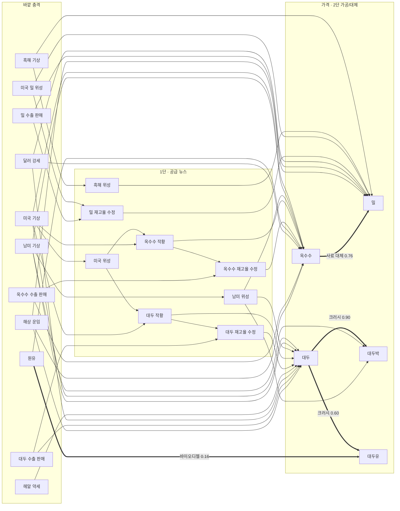

# 곡물 2단 온톨로지 — 구축 내용 · 자료 · 백테스트 로그

최종 갱신 2026-11-02 · 코드 `causal_data.py`(수집) · `causal_grain.py`(온톨로지·인과) · `range_bt.py`(구간 확률) · `defer_ont.py`(구매 미루기)
결과 파일 `data/causal_*.csv` · `data/range_bt_compare.csv` · `data/defer_ont_compare.csv`

## 한 줄 결론
- **2단 연결(가공·대체·원유)은 강하고 안정적**: 대두 → 대두박(계수 0.90) · 대두유(0.60), 옥수수 → 밀(0.76), 원유 → 대두유 — 두 기간 모두 유의, PCMCI(자료만으로 찾은 연결)도 확인.
- **1단(기상 · 작황 · WASDE · 위성 · 수출 판매 · 운임 → 가격)은 주간 가격 설명력이 거의 없음** — 새 자료를 넣어도 +0~1%p.
- 그래서 온톨로지는 **'왜 움직였나' 설명용**. 가격 범위 예측 · 구매 미루기 판단은 개선되지 않아 **대시보드 미반영**.

## 1. 온톨로지 구조 (2판, 노드 24개)

굵은 화살표 = 두 기간(2008–16 · 2017–) 모두 강하게 유의하고 PCMCI로도 확인된 연결. 1판(노드 16개) = 위성 · 수출 판매 · 운임 빼고 같음.

## 2. 자료 (모두 주간 금요일 기준, 그 시점에 공개된 값만 사용)

| 노드 | 자료 | 출처 · 키 | 기간 | 변환 · 사용 시점 |
|---|---|---|---|---|
| 미국 · 남미 · 흑해 기상 | 주산지 일별 기온 · 강수 (아이오와 · 일리노이 · 네브래스카 / 마투그로수 · 부에노스아이레스 / 로스토프 · 헤르손) | Open-Meteo ERA5, 키 없음 | 2000– | 4주 '덥고 마름' z(같은 주차 과거 대비)의 주간 변화, 생육기만(미국 6–8월 · 남미 12–3월 · 흑해 4–6월), 6일 지연 |
| 미국 · 남미 · 흑해 · 미국 밀 위성 | 위성 식생건강지수 VHI(경작지, NDVI 포함) 20개 주 | NOAA STAR, 키 없음 | 1981– | 묶음 평균의 주간 변화, 생육기만, 7일 지연 |
| 옥수수 · 대두 작황 | 주간 우량 비율(양호 + 우수 %) | USDA NASS, `NASS_API_KEY` | 1990– | 시즌 안 주간 변화 |
| 재고율 수정 | WASDE 미국 기말재고/사용량 수정 폭 | USDA WASDE(보유) | 1997– | 발표 주만, 나머지 0 |
| 수출 판매 | 주간 순판매(옥수수 · 대두 · 밀) | USDA AgTransport `wnn7-29tu`, 키 없음 | 1999– | 직전 52주 대비 z, 발표 주(목요일 마감 + 1주) |
| 해상 운임 | 걸프 → 일본 곡물 운임 $/t (월간) | USDA AgTransport `ehs5-yac3`, 키 없음 | 1996– | 월 변화, 다음 달 10일 이후 |
| 달러 · 헤알 | 달러/유로 · 헤알/달러 | FRED, 키 없음 | 2003– | 주간 로그 변화 |
| 가격 | 옥수수 · 대두 · 밀 · 대두박 · 대두유 · 원유 선물(연속월물) | 기존 수집 | 2005– | 주간 로그 수익률 % |
| (참고만) 세계 수급 | 172개국 생산 · 수출 · 재고(연간) | USDA FAS PSD, 키 없음 | 1960– | **과거 발표 시점 값이 없어 주간 모형 미사용** |

받지 못한 것: NOPA 압착량(회원 전용 → 대안 NASS 월간 압착), 브라질 CONAB · 아르헨티나 원자료(사이트 접속만 확인), 후방 산업 탄력성(제외). NOAA 키(`.env` `NOAA_TOKEN`)는 기상 관측소용(NCEI CDO) — 미사용.

## 3. 백테스트 결과

### ① 정책 이벤트 반사실 (곡물 밖 13품목 대조, 위약 400회) — `data/causal_events.csv`
| 이벤트 | 품목 | 5일 초과 | p | 20일 초과 | p | 판단 |
|---|---|---|---|---|---|---|
| 러시아 우크라이나 침공 2022-02-24 | 밀 | +19.5% | <0.001 | +13.4% | 0.10 | 유의 |
| 중국 보복관세 2018-06-15 | 대두 | −4.3% | 0.07 | −11.7% | 0.03 | 20일 유의 |
| 흑해 협정 체결 2022-07-22 | 밀 | −1.1% | 0.78 | −13.5% | 0.09 | 우연 수준 |
| 러시아 흑해 협정 탈퇴 2023-07-17 | 밀 | +5.7% | 0.16 | −5.3% | 0.44 | 우연 수준 |
| 인도 밀 수출 금지 2022-05-16 | 밀 | −7.7% | 0.04 | −10.4% | 0.15 | 예상과 반대 |
| 아르헨티나 대두 달러 2022-09-05 | 대두박 | +4.7% | 0.14 | −8.1% | 0.27 | 예상과 반대 |

### ② 구조 모형 · 역방향 추적 (결과 → 원인) — `data/causal_scm_*.csv`, `causal_backtrace.csv`
| 가격 | 설명 몫 1판 → 2판 | 시험 R²(2008–16 계수로 2017–) |
|---|---|---|
| 대두박 | 61% → 61% | 0.50 |
| 밀 | 42% → 43% | 0.34 |
| 대두유 | 40% → 40% | 0.32 |
| 대두 | 14% → 14% | −0.05 |
| 옥수수 | 8% → 9% | −0.16 |

- 분해 검산 오차 1e−14 (원인별 기여 합 = 실제).
- 1단에서 두 기간 같은 부호로 의미 있던 연결: 밀 수출 판매 → 밀 재고율 수정(t −3.5), 흑해 기상 → 흑해 위성(t −2.5).
- 사례: 2012 미국 가뭄 옥수수 +37.5% 중 작황 경로 +8%, 설명 안 됨 +28%. 2022 전쟁 밀 +31% 중 옥수수 경로 +12.5%.

### ③ PCMCI (편상관, 최대 2주 시차, 직접 구현) — `data/causal_pcmci.csv`
- 확인: 옥수수 → 밀, 대두 → 대두박 · 대두유, 원유 → 대두유, 미국 · 남미 기상 → 위성, 달러 → 밀.
- 미확인: 작황 → 재고율 → 가격 1단 사슬 전부.
- 온톨로지 밖 후보 약 40개는 생육기 마스킹 · 다중 검정 탓으로 보고 미채택(예: 미국 위성 → 흑해 위성).

### ④ 가격 구간 확률 예측 (ForecastBench 방식) — `data/range_bt_compare.csv`
4 · 13주 뒤 5구간 확률 · 오를 확률 · 80% 범위, RPS · Brier · 적중률, 시험 2017– (약 500주).
| 모형 | 결과 |
|---|---|
| M1 변동성 (vs 과거 분포) | 4주 대두박 +1.7%(t 2.1), 대두유 +2.4%(t 2.4) — 두 기간 모두 개선. 나머지 ≈ 0 |
| M2 온톨로지 (vs M1) | 13주 밀 +1.4% · 대두박 +2.4%(유의 아님), 나머지 악화(−0.2 ~ −4%) |
| M3 24개 전부 (vs M1) | 모든 경우 악화 −2 ~ −13%(t 최대 −3.4) → 도메인으로 거르는 게 낫지만 그것도 기준을 못 넘음 |
| 오를 확률 Brier | ≈ 0.25 (동전 수준) |

### ⑤ 구매 '지금 살까, 미룰까' + 온톨로지 — `data/defer_ont_compare.csv`
규칙은 대시보드와 같음(τ 0.6 · p* 0.55 · 최대 2 · 4주 · 매주 재평가), 하락 확률 모형 특성만 바꿈. 2008년부터 학습, 비교 2013–16 · 2017–.
- 시험 AUC는 모든 조합 0.46–0.54 (동전 수준) — 기본 모형도 같음.
- 채택 기준(두 기간 절감 + · 시험 AUC +) 통과: **+원인 4/10** (밀 2주 · 대두박 2주 · 대두 4주 · 대두유 4주), **+분해 2/10** (대두박 · 옥수수 2주) — 세 조건이 우연히 맞을 확률(약 1/8)보다 조금 많은 정도.
- 가장 좋아 보인 '밀 2주 +원인'(AUC 0.515 → 0.541, 절감 +24 · +12bp)을 **KC 밀(새 품목)로 확인 → 2013–16 −8.6bp로 재현 안 됨** → **미채택**.

## 4. 결정 기록
| 날짜 | 결정 | 근거 |
|---|---|---|
| 2026-11-02 | Backtracer(특허) 대신 공개 표준 방법(구조 모형 역사적 분해 · PCMCI · 반사실)으로 역방향 인과 추론 | 사용자 요청 |
| 2026-11-02 | NASA MODIS 불필요 — NOAA VHI로 대체 | 경작지 주간 지수 · 키 불필요 |
| 2026-11-02 | 온톨로지 = 설명용, 대시보드 예측 · 구매 판단 미반영 | ② · ④ · ⑤ 모두 기준 미달 |
| 2026-11-02 | 구간 확률은 '변동성 기반'만 대시보드 후보(4주 대두박 · 대두유) | ④ 두 기간 개선 · t > 2 |

## 5. 다음 후보
- 과거 WASDE 원문에서 세계 수급표(브라질 · 아르헨티나 · 흑해)를 발표 시점 값으로 파싱 → '해외 수급 수정' 노드.
- 정책 · 전쟁 같은 '이벤트 노드' 추가 (지금은 '설명 안 됨'으로 남는 큰 움직임의 원인).
- 대두박 · 밀 · 대두유 '최근 4주 원인 분해'를 참고 표로.
